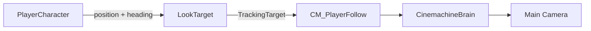

# Player controls and camera

How the player ship moves and aims, and how the camera follows it.

See also: [README](../README.md#architecture)

## Controls

| Input     | Action                                          |
|-----------|-------------------------------------------------|
| `W` / `S` | Thrust forward / backward along the ship's nose |
| `A` / `D` | Strafe left / right relative to the ship        |
| Mouse     | Aim: the ship turns to face the cursor          |

Movement is **ship-relative**, not screen-relative. Holding `W` always flies
toward where the ship points, so aiming and steering are the same gesture.
Strafing lets the ship circle a target while keeping its nose on it.

## Aiming

[`PlayerInputController`](../Assets/Code/Control%20Module/Player/PlayerInputController.cs)
reads the `Look` action as a **pointer position** in screen space, converts it
to world space with the main camera, and turns it into a target angle.

- `Update` computes the target angle from the cursor.
- `FixedUpdate` turns the `Rigidbody2D` toward it with `MoveRotation`, at a
  rate set by `rotationSpeed`.

Rotation goes through the `Rigidbody2D`, never the `Transform`, so it does not
fight the physics simulation.

### Rotation offset

The ship sprite does not point along +X, so the stored rotation is the heading
plus a sprite alignment offset:

```text
rigidbody rotation = heading + rotationOffset
heading            = rigidbody rotation - rotationOffset
```

`rotationOffset` lives only on `PlayerInputController` (90° on the
`PlayerCharacter` prefab). Anything that needs the ship's heading, such as
movement and the camera look-ahead, reads it from there rather than keeping
its own copy.

## Movement

`FixedUpdate` turns the local input into a world direction using the rotation
applied in the same physics step, then hands it to `EntityMovement`:

```text
forward = (cos heading, sin heading)
right   = forward rotated 90° clockwise
world   = forward * input.y + right * input.x
```

The rotation of the current step is used instead of `_rb.rotation`, because
`MoveRotation` only takes effect when the simulation runs, after
`FixedUpdate`.

`EntityMovement` stays unaware of orientation: it receives a world direction,
as it does for enemies.

## Camera look-ahead

The camera leads the ship in the direction it faces, so the player sees more
of what is ahead.

[`CameraLookAhead`](../Assets/Code/Control%20Module/Player/CameraLookAhead.cs)
does **not** move the camera. It moves an empty `LookTarget` object, and the
Cinemachine camera tracks that object instead of the player:



Design decisions:

- **Target proxy, not the camera.** The `CinemachineBrain` owns the Main
  Camera transform. A script writing to the camera directly would be
  overwritten every frame.
- **Execution order.** The `CinemachineBrain` runs with execution order 100,
  so the `LookTarget` update in `LateUpdate` (order 0) always runs first and
  the camera tracks the current frame's target.
- **One source for position and heading.** Both come from the player's
  `Transform`, which the `Rigidbody2D` interpolates every frame. Reading the
  rotation from the `Rigidbody2D` would only change at the physics step and
  make the look-ahead direction move in steps.
- **Depth is preserved.** Only X and Y follow the player; the target keeps its
  own Z.
- **No initial sweep.** `Start` places the target at its desired position, so
  the camera does not glide in from the scene origin.

### Adding it to a scene

1. Create an empty GameObject named `LookTarget` and add `CameraLookAhead`.
2. Assign the player's `PlayerInputController` to its **Player** field.
3. Set the Cinemachine camera's **Tracking Target** to `LookTarget`.

`Enemy HSTM Test Bed` is already set up this way.

## Tuning

| Component                     | Field               | Effect                                                    |
|-------------------------------|---------------------|-----------------------------------------------------------|
| `PlayerInputController`       | `rotationOffset`    | Aligns the sprite's nose with the heading                 |
| `PlayerInputController`       | `rotationSpeed`     | How fast the ship turns toward the cursor                 |
| `EntityStats`                 | `speed`             | Flight speed                                              |
| `CameraLookAhead`             | `lookAheadDistance` | How far ahead of the ship the camera aims, in world units |
| `CameraLookAhead`             | `smoothSpeed`       | How fast the target catches up with its desired position  |
| `CinemachinePositionComposer` | `Damping`           | Camera smoothing on top of `smoothSpeed`                  |

`smoothSpeed` and the Position Composer damping add up. If the camera feels
sluggish, lower the damping before raising `smoothSpeed`.

## Known limitations

- **Aim and camera feed each other.** The aim depends on the camera, and the
  camera follows the ship's rotation. With the mouse still, moving the camera
  shifts the cursor's world position, so the ship can keep turning slightly
  until both settle. Basing the look-ahead on the cursor's offset from the
  screen center would break the loop.
- **No analog speed.** `EntityMovement.Move` normalizes the direction, so a
  half-pressed stick moves at full speed.
- **Mouse only for aiming.** `Look` must be a pointer position. A gamepad
  stick, which reports a direction, is not supported yet.
