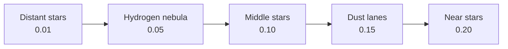

# Space background

How the procedural background is built and how to tune it: star layers,
nebula layers and their palettes.

See also: [Player controls and camera](player-controls.md) ·
[Web build](web-build.md)

## Overview

The background is one quad behind the camera, drawn by
[`SpaceBackgroundRenderer`](../Assets/Code/Scenario/Starfield/SpaceBackgroundRenderer.cs)
with the `TheInvasion/Starfield/Procedural` shader. Nothing in it is a
texture or a sprite: every star and every cloud is computed from the world
position, a seed and time.

- **Deterministic.** The same place always looks the same. Flying away and
  coming back shows the same stars and the same nebulae.
- **One pass.** Star and nebula layers are composed in a single shader pass,
  from the farthest to the nearest, so they can cover and tint each other.
- **WebGL compatible.** Layer data travels as uniform arrays and the shader
  targets 3.5, the level WebGL 2 supports.
- **On the sprite grid.** With `pixelsPerUnit` set, everything snaps to the
  same pixel grid as the pixel art sprites.

## Assets

| Asset | Created from | Holds |
|---|---|---|
| `StarfieldConfig` | *The Invasion > Starfield Configuration* | World seed and star layers |
| `NebulaConfig` | *The Invasion > Nebula Configuration* | Nebula layers, regions, star interaction, animation rate |
| `NebulaPalette` | *The Invasion > Nebula Palette* | The discrete colors of a nebula layer |

They are separate on purpose. The starfield tends to stay the same across
the game, while nebulae are what changes between sectors: a sector swaps its
`NebulaConfig` and keeps its stars. Palettes are shared between layers and
configs.

The examples live in `Assets/Prefab/Scenario/StarField/` and are wired to
the `Starfield` object in `Enemy HSTM Test Bed`.

## Layer order is depth

Every layer, star or nebula, has a **parallax factor**: how much it follows
the camera. A low factor is far away, a high one is close. The renderer
merges both configs and draws them sorted by that factor, so a nebula sits
between two star layers simply by having a factor between theirs.

On a tie, the star layer is drawn first and the nebula covers it.

## Nebula kinds

| Kind | Effect on what is behind it |
|---|---|
| **Emission** | Glowing gas. Dims what is behind by its *veil*, then adds its own light. |
| **Dust** | Dark dust. Hides what is behind, up to its *absorption*. Layers in front are untouched. |

Dust is the strongest depth cue: stars behind a lane disappear while nearer
stars pass over it.

## How a nebula is drawn

1. **Snap** the pixel to the layer's grid: blocks of `pixelScale` × `pixelScale`
   sprite pixels. `1` matches the sprites; `2` or `3` give a chunkier cloud
   that sits better behind 33×33 sprites while the stars keep 1-pixel detail.
   The layer also scrolls in whole blocks, so it never slides through its own
   blocks.
2. **Shape:** fractal gradient noise (Perlin-style) of `octaves` octaves at
   the scale of `cloudSize`, bent by a second noise (`warp`) into gas-like
   filaments.
3. **Cut:** values under `threshold` are empty space; `contrast` sets how
   fast the edge reaches the densest tone.
4. **Region:** a very low frequency noise splits the map into regions
   (`regionSize` in the config). A layer only appears where that noise falls
   between its `regionMin` and `regionMax`, so different layers own different
   parts of the map. `0` to `1` means everywhere.
5. **Tones:** the density is reduced to the palette's tones with 4×4 ordered
   dithering between them, one dither cell per block. The dither pattern is
   anchored to the layer, so it travels with the cloud instead of crawling
   over it.
6. **Color:** each tone is one palette color, used exactly as picked.

## Movement over time

The overall shape of a nebula depends only on its position, so it never
moves and stays recognizable. Only the details flow:

- The warp noise is sampled along a circle in noise space. Over
  `cyclePeriod` seconds the details drift and twist, then return to the exact
  same shape, so there is no seam and no drift.
- `flowRadius` is how far they drift: `0` freezes the layer, small values
  read as slow breathing. Real nebulae are effectively still on a human time
  scale, so subtle is closer to reality.
- The flow advances `animationFrameRate` times per second (10 by default, the
  rate of the sprites' animations), so tone edges change in frames instead of
  shimmering every frame.

Time comes from a clock owned by the renderer, not `Time.time`:

- A paused game (`Time.timeScale = 0`) freezes the clouds.
- `SpaceBackgroundRenderer.NebulaTime` is the whole time state. Saving and
  restoring it, together with the camera position, brings the background back
  exactly as it was.

## Interaction with stars

Set in the `NebulaConfig`, applied to star layers drawn after an emission
layer:

| Setting | Effect |
|---|---|
| `starHalo` | Stars in front of an emission cloud get a glow tinted by the cloud, as if lighting it. |
| `starCluster` | Extra star density inside emission regions, like star-forming regions. `2` triples it. |

Clustering follows the smooth region weight rather than the dithered cloud,
so every pixel of a star agrees on whether it exists.

## Palettes

A `NebulaPalette` is a list of 1 to 6 colors, from the faintest to the
densest tone. Empty space is not part of it.

- **Exact colors.** The project uses the linear color space; the renderer
  converts the palette on the way in, so the pixel on screen is the hex that
  was picked.
- **Import.** The inspector takes a pasted list of hex colors, as exported by
  Aseprite or Lospec (`#222034, #3f3f74` or one `222034` per line), and
  replaces the tones.
- **Readability warning.** The inspector warns when the brightest tone's
  relative luminance goes above `luminanceWarning` (0.12 by default): the
  nebula may start to compete with ships and projectiles. The layer's
  `intensity` scales the colors further.

Dark, low-saturation tones read best. Real space is close to black, and
nebulae are faint to the naked eye; the saturated colors of telescope
pictures come from long exposures and false-color filters. The player ship's
teal and the enemies' red and blue are worth keeping out of the palettes so
gameplay always stands out.

## Editing and preview

- The renderer runs in the editor (`[ExecuteAlways]`): the Game view shows
  the background without entering Play mode. The flow only moves in Play
  mode.
- Changes to any of the three assets or to the renderer apply immediately,
  in the editor and in Play mode.
- *Rebuild Background* in the renderer's context menu forces a rebuild.

## Limits

| Limit | Value | Where |
|---|---|---|
| Star layers | 8 | `StarfieldLayerData.MaxLayers` / `STARFIELD_MAX_LAYERS` |
| Nebula layers | 4 | `NebulaLayerData.MaxLayers` / `NEBULA_MAX_LAYERS` |
| Tones per palette | 6 | `NebulaPalette.MaxTones` |
| Noise octaves | 6 | `STARFIELD_MAX_OCTAVES` |

Extra layers are ignored with a warning. Raising a limit means changing the
C# constant and the matching shader define together.

## Cost

Each nebula layer evaluates about ten noise samples per pixel where its
region is active; outside its region it is skipped. Two or three nebula
layers are comfortable on a desktop GPU. If the web build struggles on
integrated graphics, the next step is rendering the background into a texture
at the sprite grid's resolution and scaling it up, which divides the cost by
the square of the pixel size.
