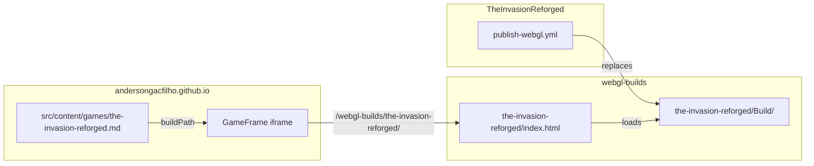

# Web build

How the game is built for WebGL and published to the personal site.

See also: [GitHub automation](github-automation.md) ·
[Development setup](development-setup.md)

The published build is playable at
<https://andersongacfilho.github.io/play/the-invasion-reforged/> and listed on
<https://andersongacfilho.github.io/games/>.

## Where the build lives

The site does not host builds itself. They live in the
[`webgl-builds`](https://github.com/AndersonGACFilho/webgl-builds) repository,
which GitHub Pages serves from the same origin, and the site embeds them in an
iframe:

| Piece                                 | Owner                        | Changed by the workflow      |
|---------------------------------------|------------------------------|------------------------------|
| `the-invasion-reforged/Build/`        | `webgl-builds`               | Yes, replaced each time      |
| `the-invasion-reforged/index.html`    | `webgl-builds`, hand-written | Only the `?v=` on build URLs |
| Game card, controls text, `live` flag | site, `src/content/games/`   | No                           |

`index.html` is written for the site: it reads the language from `?lang=`,
makes the canvas fill the iframe and shows its own loading bar. It loads
`Build/WebGL.loader.js`, `WebGL.data`, `WebGL.framework.js` and `WebGL.wasm`
by name, which is why the workflow builds with `buildName: WebGL` and refuses
to publish if any of those files is missing.

### Cache busting

Every build reuses the same file names, and GitHub Pages lets browsers keep
each file for 10 minutes (`cache-control: max-age=600`), on top of Unity's own
IndexedDB cache of the `.data`. A returning visitor could then load the new
`.wasm` with an old `.data`, which crashes at startup with
`RuntimeError: memory access out of bounds`.

So the workflow appends a version to the four build URLs in `index.html`, for
example `Build/WebGL.data?v=57180a1928c4`. The version is a hash of the build's
content, not of the commit: a new build gets new URLs that no cache has seen,
and an identical build keeps the same URLs and still publishes nothing. If
`index.html` stops referencing any of the four files, the step fails instead
of publishing a build that would load stale files.

## How it works

The [`publish-webgl.yml`](../.github/workflows/publish-webgl.yml) workflow
runs when started by hand from the **Actions** tab, or when a `v*` tag is
pushed.

1. **Build** — checks the secrets, checks out the project with LFS, restores
   the `Library` cache and builds WebGL through
   [GameCI](https://game-ci.com/), with the editor version from
   `ProjectSettings/ProjectVersion.txt`. The `Build/` folder is kept as a
   one-day artifact.
2. **Publish** — checks out `webgl-builds` with a deploy key, replaces
   `the-invasion-reforged/Build/`, updates the `?v=` version in `index.html`
   (see [cache busting](#cache-busting)), commits and pushes. If the build is
   identical to the published one, nothing is committed.

GitHub Pages on `webgl-builds` picks up the push on its own; the new build is
live a minute or two later. The site itself does not need to be rebuilt.

It does not run on every push to `master` on purpose: each publish commits
about 60 MB of binaries to `webgl-builds`, whose history keeps all of them.

## One-time setup

### 1. Unity account

The build activates a Personal (free) seat with the Unity account's email and
password: GameCI requests a seat for the runner at the start of the build and
returns it at the end. No license file is involved.

The account needs a real password: accounts that sign in only through Google,
GitHub or Apple must set one at id.unity.com first.

A `.ulf` license file is **not** used on purpose. GameCI now reserves file
activation for Enterprise and Industry seats, and with Unity 6 it cannot
confirm a file activation: it looks for a log line Unity 6 no longer prints,
so every build retried the activation five times, about seven minutes, before
carrying on.

### 2. Repository secrets

| Secret                    | Value                                          |
|---------------------------|------------------------------------------------|
| `UNITY_EMAIL`             | Email of the Unity account                     |
| `UNITY_PASSWORD`          | Password of the Unity account                  |
| `WEBGL_BUILDS_DEPLOY_KEY` | Private half of the deploy key described below |

`gh secret set UNITY_EMAIL` and `gh secret set UNITY_PASSWORD` prompt for the
value, so they must run in a real terminal.

### 3. Deploy key for webgl-builds

A deploy key gives write access to `webgl-builds` and nothing else, unlike a
personal access token:

1. Generate an `ed25519` key pair with no passphrase.
2. Add the public key to `webgl-builds` as a deploy key **with write access**
   (`gh repo deploy-key add key.pub --repo AndersonGACFilho/webgl-builds --allow-write`).
3. Store the private key as `WEBGL_BUILDS_DEPLOY_KEY` in this repository
   (`gh secret set WEBGL_BUILDS_DEPLOY_KEY < key`).
4. Delete both local copies.

The workflow checks all three secrets first and fails with the names of any
missing one, before spending time on the build.

## WebGL settings that matter

| Setting (`Player` > `Web` > `Publishing Settings`) | Value    | Why                                                                                       |
|----------------------------------------------------|----------|-------------------------------------------------------------------------------------------|
| Compression Format                                 | Disabled | GitHub Pages cannot send the `Content-Encoding` headers that Brotli and Gzip builds need |

If compression is turned on later, also enable **Decompression Fallback**,
or the page stays black. The `webgl-builds` README has the full list of
export settings and the Pages limits (100 MB per file, ~1 GB per site).

## Troubleshooting

| Symptom                                            | Cause and fix                                                                                           |
|----------------------------------------------------|---------------------------------------------------------------------------------------------------------|
| `Missing repository secrets: ...`                  | Add the listed secrets (see [setup](#one-time-setup)).                                                  |
| License activation fails in the build step         | Wrong email or password, or the account has no free Personal seat. Check the seats at id.unity.com.     |
| Activation retries with "known-transient" warnings | A `UNITY_LICENSE` secret is being passed again. Remove it from the workflow: it forces file activation. |
| `Missing build/WebGL.*`                            | `BUILD_NAME` no longer matches the names `index.html` loads. Keep them in sync.                         |
| `Permission denied (publickey)` when pushing       | The deploy key was added without write access, or the secret holds the public half.                     |
| Page stays on the loading bar                      | Open `/webgl-builds/the-invasion-reforged/` directly and read the console; usually compression (above). |
| Build is slow again after a package change         | Expected: the Library cache key includes `Packages/`, so the editor re-imports once.                    |
| `memory access out of bounds` right at startup     | Files from two builds mixed in a cache. Reload with Ctrl+Shift+R; check `index.html` still has `?v=`.   |
| `index.html no longer references Build/WebGL.*`    | `index.html` was edited and lost a build URL. Restore the four `Build/WebGL.*` references.              |
